Windows apps, iPhone apps, browser extensions and plugins. Designed and built end to end, by one person.

**[angleford.co](https://angleford.co)** &nbsp;·&nbsp; [Telegram](https://t.me/where_00)

 

**Eleven tools.** Open any line.

<b>Tempro</b> &nbsp;—&nbsp; Automatic time tracking for Windows. Windows

 

<a href="https://github.com/Piwqust/tempro/releases/latest"><b>Download</b></a> &nbsp;·&nbsp; <a href="https://tempro.angleford.co/">tempro.angleford.co</a> &nbsp;·&nbsp; <a href="https://github.com/Piwqust/tempro">Source</a>

<b>Moonbow</b> &nbsp;—&nbsp; A fast, quiet video and music player. Windows

 

<a href="https://github.com/Piwqust/moonbow/releases/latest"><b>Download</b></a> &nbsp;·&nbsp; <a href="https://moonbow.angleford.co">moonbow.angleford.co</a> &nbsp;·&nbsp; <a href="https://github.com/Piwqust/moonbow">Source</a>

<b>V2pn</b> &nbsp;—&nbsp; A simple VPN client for Windows and macOS. Windows · macOS

 

<a href="https://github.com/Piwqust/V2pn/releases/latest"><b>Download</b></a> &nbsp;·&nbsp; <a href="https://v2pn.angleford.co">v2pn.angleford.co</a> &nbsp;·&nbsp; <a href="https://github.com/Piwqust/V2pn">Source</a>

<b>Claude Profile Switcher</b> &nbsp;—&nbsp; Several Claude accounts, all signed in. Windows

 

<a href="https://github.com/Piwqust/claude-switcher/releases/latest"><b>Download</b></a> &nbsp;·&nbsp; <a href="https://claude-switcher.angleford.co">claude-switcher.angleford.co</a> &nbsp;·&nbsp; <a href="https://github.com/Piwqust/claude-switcher">Source</a>

<b>Codex Switcher</b> &nbsp;—&nbsp; Several Codex accounts, limits in view. Windows

 

<a href="https://github.com/Piwqust/codex-switcher/releases/latest"><b>Download</b></a> &nbsp;·&nbsp; <a href="https://github.com/Piwqust/codex-switcher">Source</a>

<b>earn›line</b> &nbsp;—&nbsp; A local-first income ledger for iPhone. iPhone

 

<a href="https://github.com/Piwqust/earnline"><b>Source</b></a>

<b>Cutoff</b> &nbsp;—&nbsp; A calm trainer for preflop decisions. iPhone

 

<a href="https://github.com/Piwqust/Cutoff"><b>Source</b></a>

<b>Fount</b> &nbsp;—&nbsp; The fonts from any website, as TTF and OTF. Web · Chrome · CLI

 

<a href="https://github.com/Piwqust/font-grabber/releases/latest"><b>Download</b></a> &nbsp;·&nbsp; <a href="https://github.com/Piwqust/font-grabber">Source</a>

<b>Pinterest Plus Plus</b> &nbsp;—&nbsp; Pins in original quality. Chrome

 

<a href="https://piwqust.github.io/pinterest-plus-plus/"><b>piwqust.github.io/pinterest-plus-plus</b></a> &nbsp;·&nbsp; <a href="https://github.com/Piwqust/pinterest-plus-plus">Source</a>

<b>Blackboard Text</b> &nbsp;—&nbsp; Notes you can draw over. Web · PWA

 

<a href="https://piwqust.github.io/blackboard/"><b>piwqust.github.io/blackboard</b></a> &nbsp;·&nbsp; <a href="https://github.com/Piwqust/blackboard">Source</a>

<b>orvey</b> &nbsp;—&nbsp; Images and concepts inside your AI chat. MCP plugin

 

<a href="https://orvey.angleford.co"><b>orvey.angleford.co</b></a> &nbsp;·&nbsp; <a href="https://github.com/Piwqust/orvey-plugin">Source</a>

Also: [**LintSense**](https://github.com/Piwqust/lintsense), a Figma plugin that turns a file's colors and type into Variables and Text Styles, and [**Lyrics Live**](https://github.com/Piwqust/LyricsLive-releases), song lyrics on stage for Resolume.

<!-- shipped:start -->
Recently shipped: <a href="https://github.com/Piwqust/V2pn/releases/tag/v1.5.0">V2pn 1.5.0</a>, Nov 24 &nbsp;·&nbsp; <a href="https://github.com/Piwqust/moonbow/releases/tag/v0.4.0">Moonbow 0.4.0</a>, Nov 24 &nbsp;·&nbsp; <a href="https://github.com/Piwqust/codex-switcher/releases/tag/v1.1.0">Codex Switcher 1.1.0</a>, Nov 21 &nbsp;·&nbsp; <a href="https://github.com/Piwqust/tempro/releases/tag/v0.4.1">Tempro 0.4.1</a>, Nov 20
<!-- shipped:end -->

Figma · TypeScript · React · Swift & SwiftUI · C++ · Rust & WebAssembly · Python · Tauri
