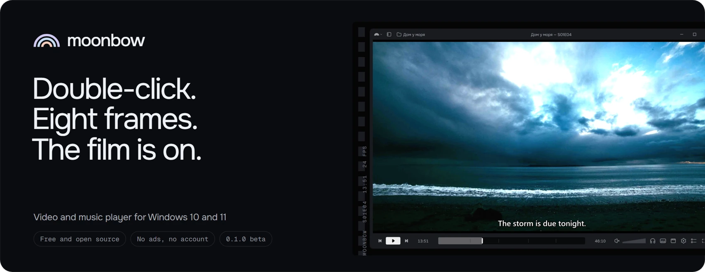
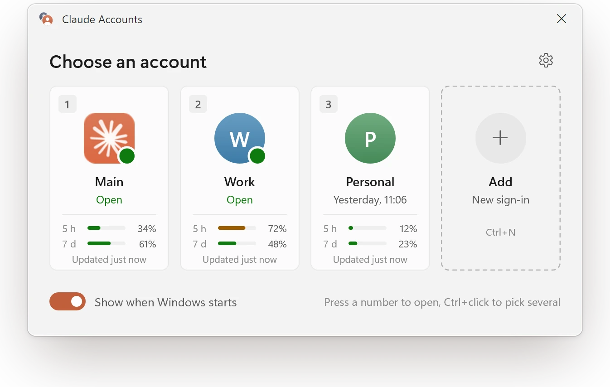
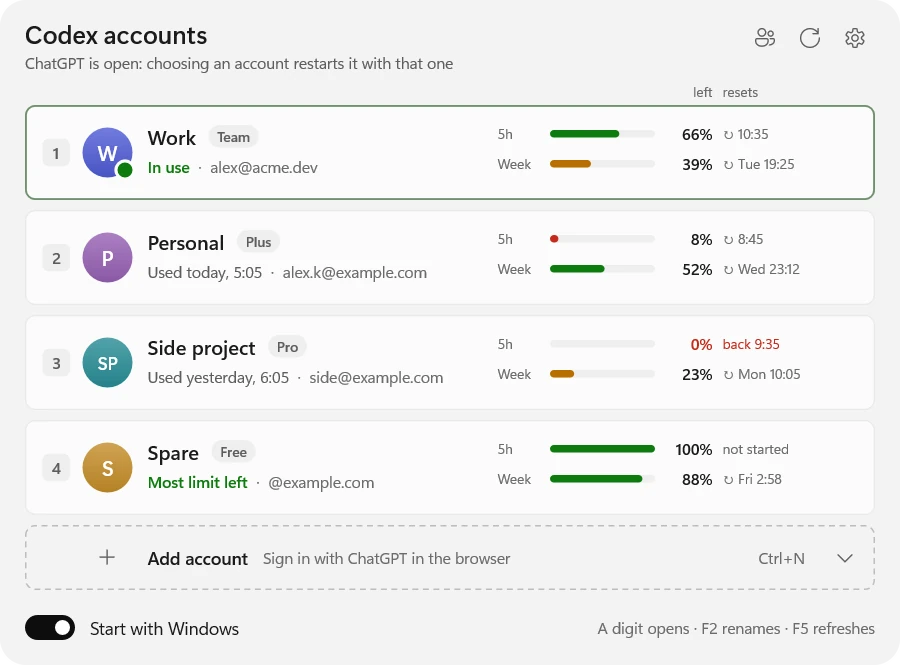
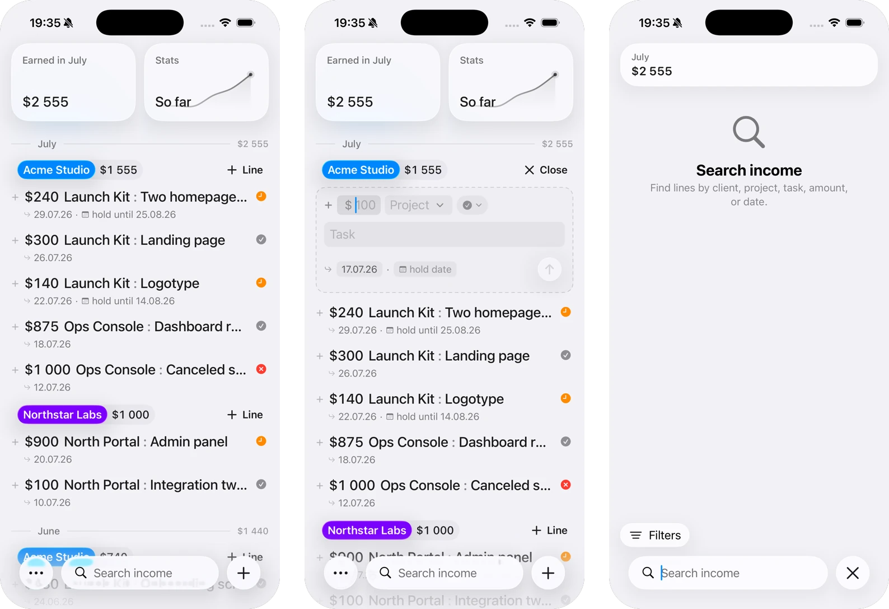
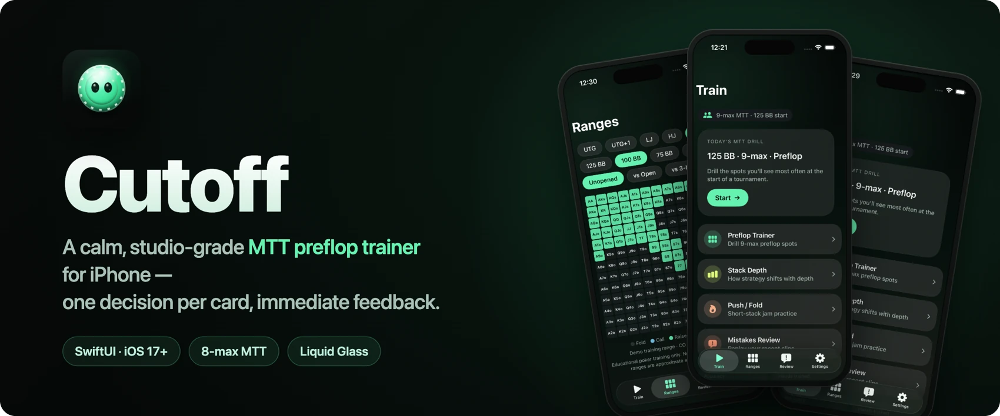
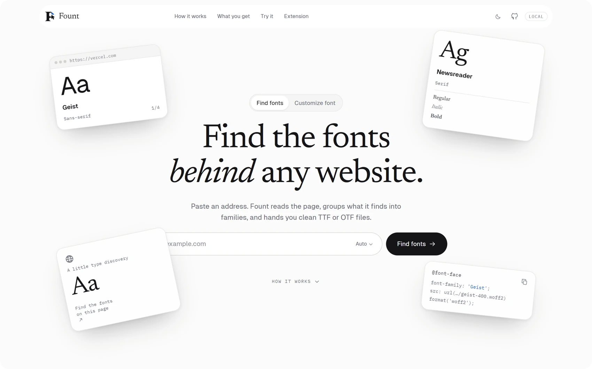
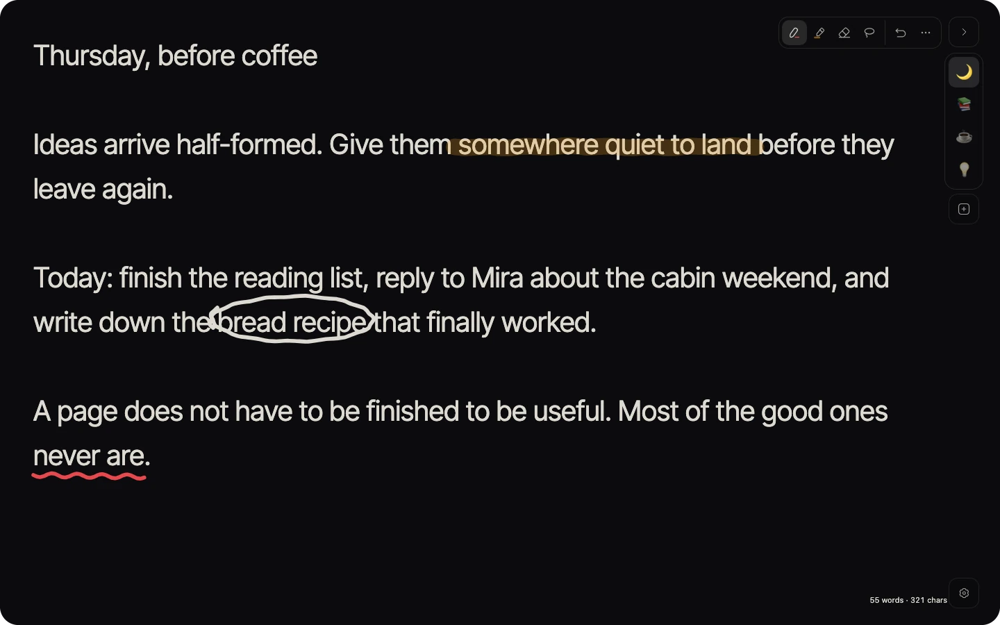
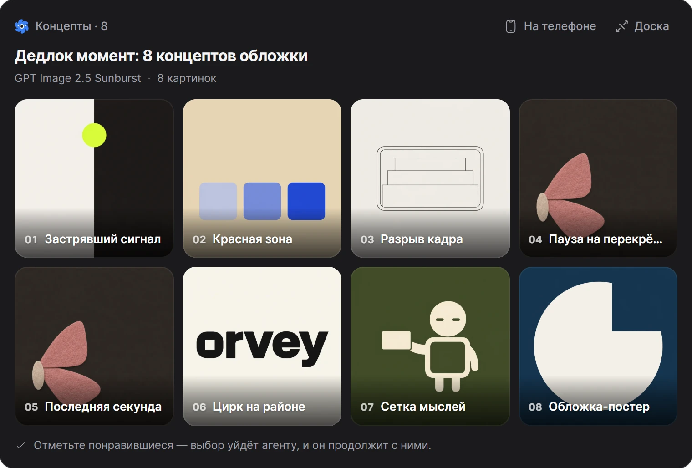

<a href="https://angleford.co"><picture><source media="(prefers-color-scheme: dark)" srcset="assets/hero-dark.svg"></picture></a>

Windows apps, iPhone apps, browser extensions and plugins. Designed and built end to end, by one person.

**[angleford.co](https://angleford.co)** &nbsp;·&nbsp; [Telegram](https://t.me/where_00)

 

**Eleven things that annoyed me, and what I built about each.** Open any line.

“Where did my day actually go?” &nbsp;→&nbsp; <b>Tempro</b> Windows

 
<a href="https://github.com/Piwqust/tempro"><picture><source media="(prefers-color-scheme: dark)" srcset="assets/cover-tempro-dark.svg"></picture></a>

Automatic time tracking for Windows. It records the computer by itself, works out the project behind every window and answers for a day, a week or a whole year. Local and encrypted. 
<a href="https://github.com/Piwqust/tempro/releases/latest"><b>Download</b></a> &nbsp;·&nbsp; <a href="https://tempro.angleford.co/">tempro.angleford.co</a> &nbsp;·&nbsp; <a href="https://github.com/Piwqust/tempro">Source</a>

“I double-click a film, and then I wait.” &nbsp;→&nbsp; <b>Moonbow</b> Windows

 

A fast, quiet video and music player for Windows with a media library. Double-click, eight frames, the film is on. No ads, no account. 
<a href="https://github.com/Piwqust/moonbow/releases/latest"><b>Download</b></a> &nbsp;·&nbsp; <a href="https://moonbow.angleford.co">moonbow.angleford.co</a> &nbsp;·&nbsp; <a href="https://github.com/Piwqust/moonbow">Source</a>

“VPN clients are built for network engineers.” &nbsp;→&nbsp; <b>V2pn</b> Windows · macOS

 

A simple VPN client for your provider's servers, built on v2rayN. Pick a country and press Connect. VLESS, Hysteria2, Trojan and more. 
<a href="https://github.com/Piwqust/V2pn/releases/latest"><b>Download</b></a> &nbsp;·&nbsp; <a href="https://v2pn.angleford.co">v2pn.angleford.co</a> &nbsp;·&nbsp; <a href="https://github.com/Piwqust/V2pn">Source</a>

“Claude Desktop lets me into one account at a time.” &nbsp;→&nbsp; <b>Claude Profile Switcher</b> Windows

 
<a href="https://github.com/Piwqust/claude-switcher"><picture><source media="(prefers-color-scheme: dark)" srcset="assets/cover-claude-switcher-dark.webp"></picture></a>

Several Claude Desktop accounts on one Windows PC: each in its own window, all signed in at once, with every account's limits in view. 
<a href="https://github.com/Piwqust/claude-switcher/releases/latest"><b>Download</b></a> &nbsp;·&nbsp; <a href="https://claude-switcher.angleford.co">claude-switcher.angleford.co</a> &nbsp;·&nbsp; <a href="https://github.com/Piwqust/claude-switcher">Source</a>

“Which Codex account still has limits left?” &nbsp;→&nbsp; <b>Codex Switcher</b> Windows

 
<a href="https://github.com/Piwqust/codex-switcher"><picture><source media="(prefers-color-scheme: dark)" srcset="assets/cover-codex-switcher-dark.webp"></picture></a>

Several Codex accounts on one Windows PC: pick one and ChatGPT opens with it, the CLI and VS Code switch too, and every account's limits stay in view. 
<a href="https://github.com/Piwqust/codex-switcher/releases/latest"><b>Download</b></a> &nbsp;·&nbsp; <a href="https://github.com/Piwqust/codex-switcher">Source</a>

“What did I actually earn this month?” &nbsp;→&nbsp; <b>earn›line</b> iPhone

 

A calm, local-first income ledger for independent work, built with SwiftUI. Your numbers stay on the phone. 
<a href="https://github.com/Piwqust/earnline"><b>Source</b></a>

“Preflop charts never stick in my head.” &nbsp;→&nbsp; <b>Cutoff</b> iPhone

 

A calm iPhone trainer for No-Limit Hold'em tournament preflop decisions: one decision per card, immediate feedback. For study only, no real money. 
<a href="https://github.com/Piwqust/Cutoff"><b>Source</b></a>

“What font is that site using?” &nbsp;→&nbsp; <b>Fount</b> Web · Chrome · CLI

 
<a href="https://github.com/Piwqust/font-grabber"><picture><source media="(prefers-color-scheme: dark)" srcset="assets/cover-font-grabber-dark.webp"></picture></a>

Paste an address. Fount reads the page, groups what it finds into families and hands you clean TTF or OTF files. A local web app, a Chrome extension and a CLI on Rust and WebAssembly. 
<a href="https://github.com/Piwqust/font-grabber/releases/latest"><b>Download</b></a> &nbsp;·&nbsp; <a href="https://github.com/Piwqust/font-grabber">Source</a>

“Pinterest won't hand over the original file.” &nbsp;→&nbsp; <b>Pinterest Plus Plus</b> Chrome

 

A free Chrome extension for Pinterest: download images and videos in original quality, copy pins as PNG and resize the grid. No tracking. 
<a href="https://piwqust.github.io/pinterest-plus-plus/"><b>piwqust.github.io/pinterest-plus-plus</b></a> &nbsp;·&nbsp; <a href="https://github.com/Piwqust/pinterest-plus-plus">Source</a>

“I want to scribble over my own notes.” &nbsp;→&nbsp; <b>Blackboard Text</b> Web · PWA

 

A free, local-first notes app in the browser: write, then draw over your text. No account, works offline. A PWA and a Chrome and Edge extension. 
<a href="https://piwqust.github.io/blackboard/"><b>piwqust.github.io/blackboard</b></a> &nbsp;·&nbsp; <a href="https://github.com/Piwqust/blackboard">Source</a>

“To make a picture I have to leave the chat.” &nbsp;→&nbsp; <b>orvey</b> MCP plugin

 

Images and concepts right in Claude, ChatGPT, Claude Code and Codex: ask for a picture, get options, pick one, keep working. Every picture is kept in your own studio. 
<a href="https://orvey.angleford.co"><b>orvey.angleford.co</b></a> &nbsp;·&nbsp; <a href="https://github.com/Piwqust/orvey-plugin">Source</a>

Also: [**LintSense**](https://github.com/Piwqust/lintsense), a Figma plugin that turns a file's colors and type into Variables and Text Styles, and [**Lyrics Live**](https://github.com/Piwqust/LyricsLive-releases), song lyrics on stage for Resolume.

<!-- shipped:start -->
Recently shipped: <a href="https://github.com/Piwqust/codex-switcher/releases/tag/v1.1.0">Codex Switcher 1.1.0</a>, Nov 21 &nbsp;·&nbsp; <a href="https://github.com/Piwqust/moonbow/releases/tag/v0.3.0">Moonbow 0.3.0</a>, Nov 21 &nbsp;·&nbsp; <a href="https://github.com/Piwqust/tempro/releases/tag/v0.4.1">Tempro 0.4.1</a>, Nov 20 &nbsp;·&nbsp; <a href="https://github.com/Piwqust/font-grabber/releases/tag/v3.2.0">Fount 3.2.0</a>, Nov 20
<!-- shipped:end -->

Figma · TypeScript · React · Swift & SwiftUI · C++ · Rust & WebAssembly · Python · Tauri
