<picture>
  <source media="(prefers-color-scheme: dark)" srcset="assets/hero-dark.webp">
  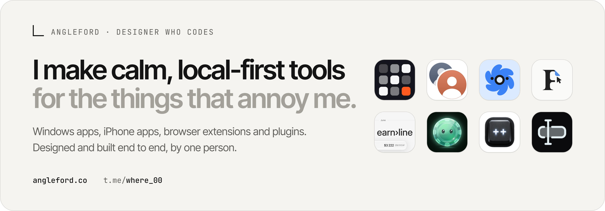
</picture>

  <a href="https://angleford.co">angleford.co</a> &nbsp;·&nbsp; <a href="https://t.me/where_00">Telegram</a>

### Selected work

  <a href="https://github.com/Piwqust/tempro#gh-light-mode-only">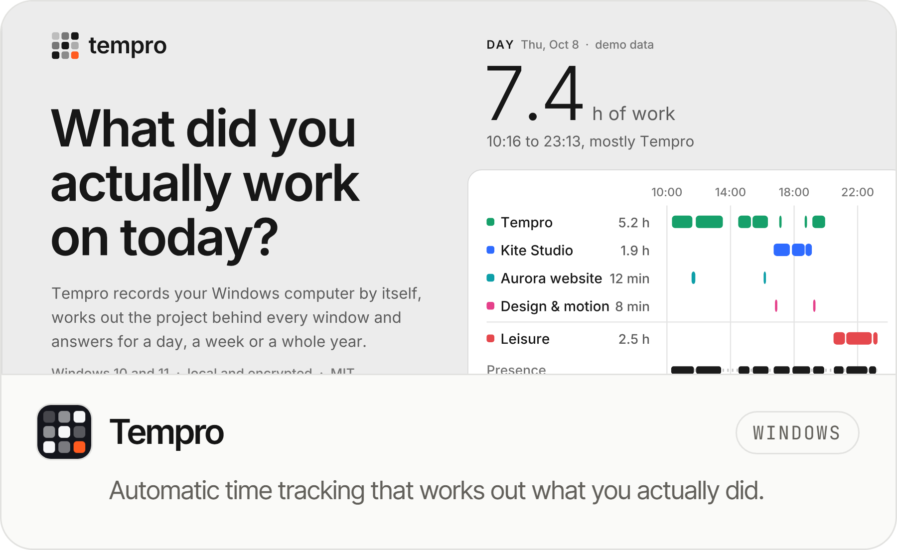</a>
  <a href="https://github.com/Piwqust/claude-switcher#gh-light-mode-only">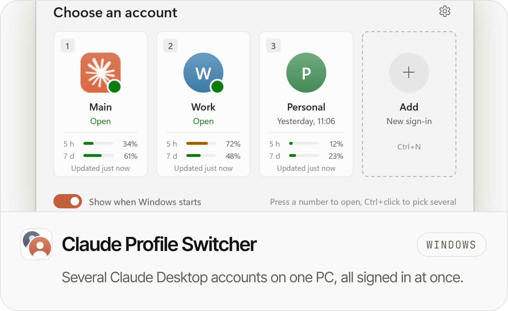</a>
  <a href="https://github.com/Piwqust/tempro#gh-dark-mode-only">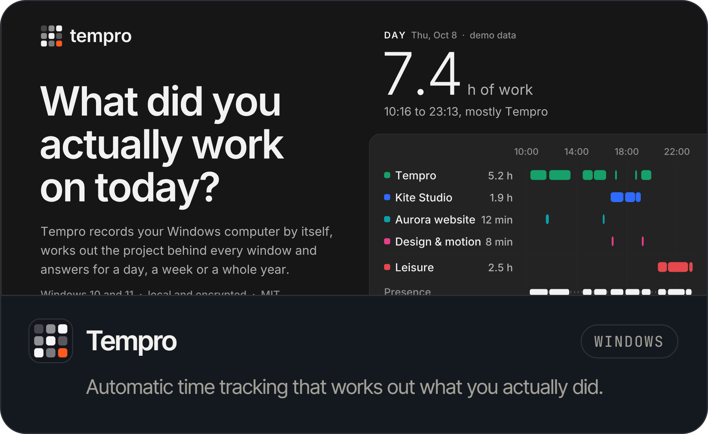</a>
  <a href="https://github.com/Piwqust/claude-switcher#gh-dark-mode-only">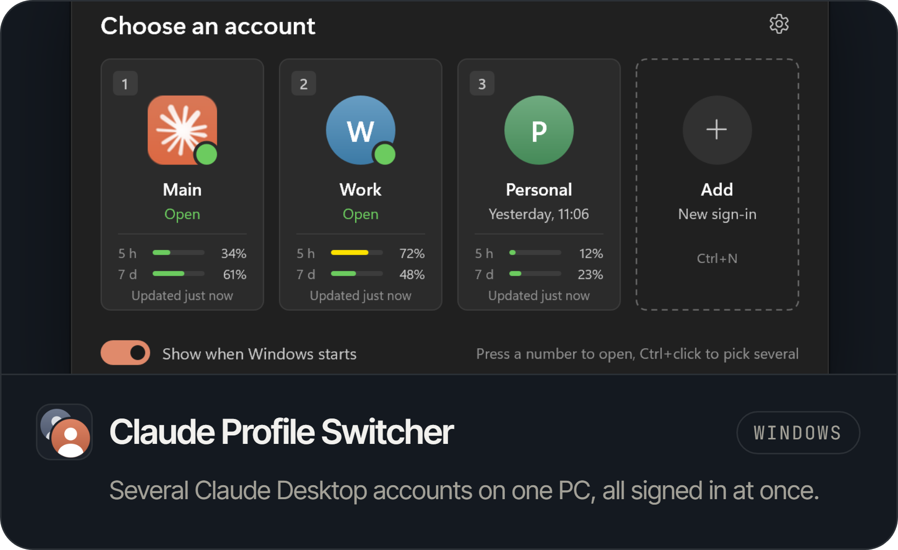</a>

  <a href="https://github.com/Piwqust/orvey-plugin#gh-light-mode-only">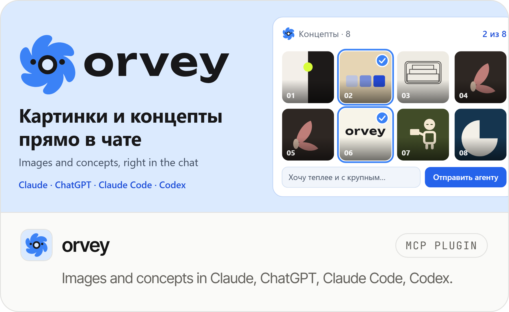</a>
  <a href="https://github.com/Piwqust/font-grabber#gh-light-mode-only">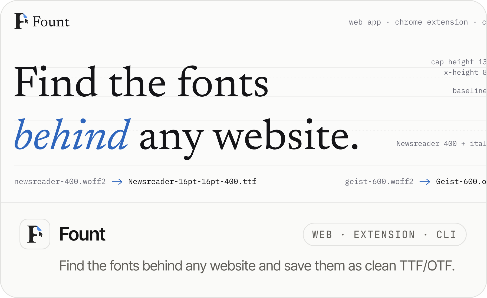</a>
  <a href="https://github.com/Piwqust/orvey-plugin#gh-dark-mode-only">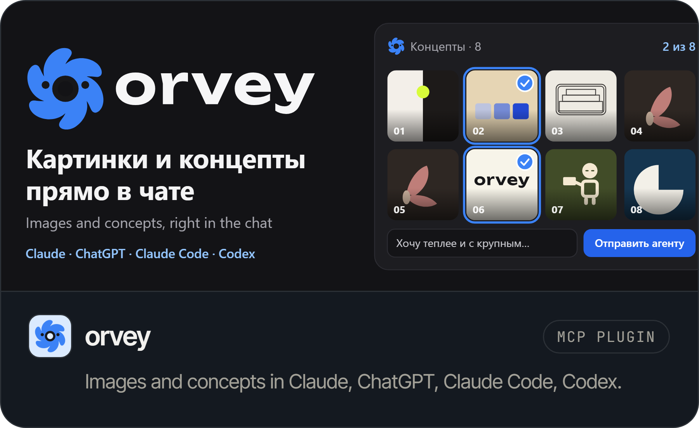</a>
  <a href="https://github.com/Piwqust/font-grabber#gh-dark-mode-only">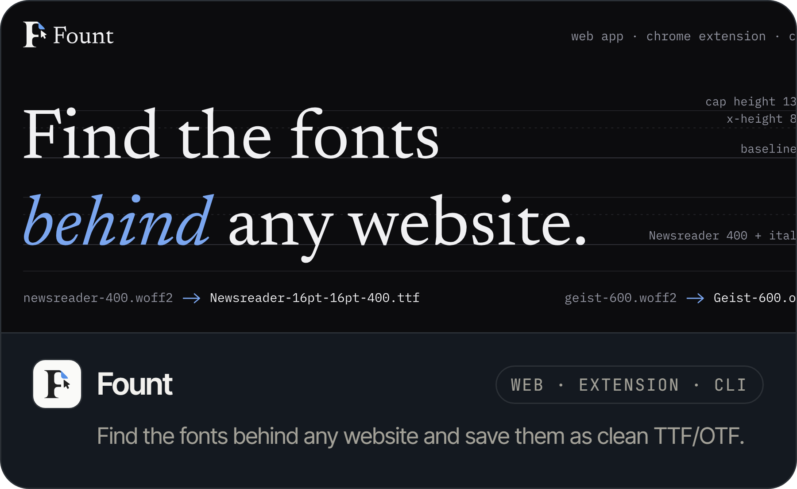</a>

  <a href="https://github.com/Piwqust/earnline#gh-light-mode-only">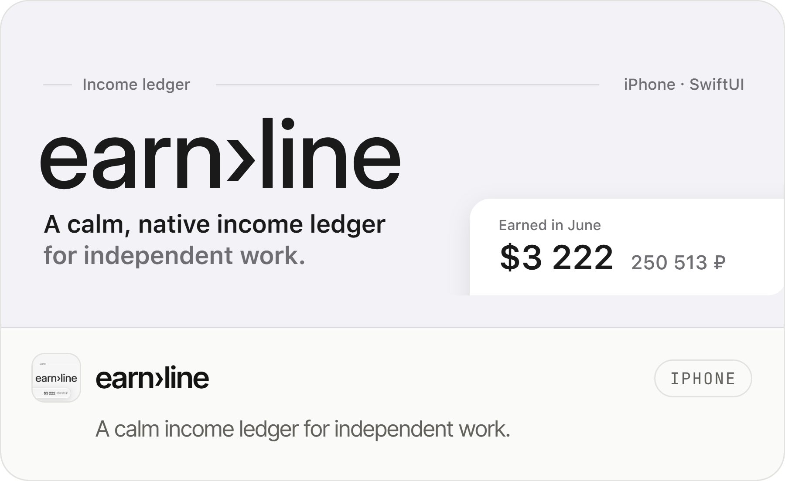</a>
  <a href="https://github.com/Piwqust/Cutoff#gh-light-mode-only">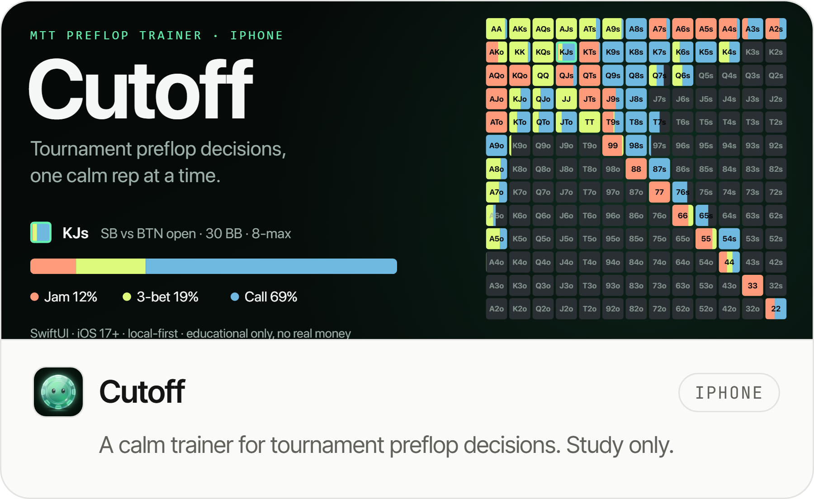</a>
  <a href="https://github.com/Piwqust/earnline#gh-dark-mode-only">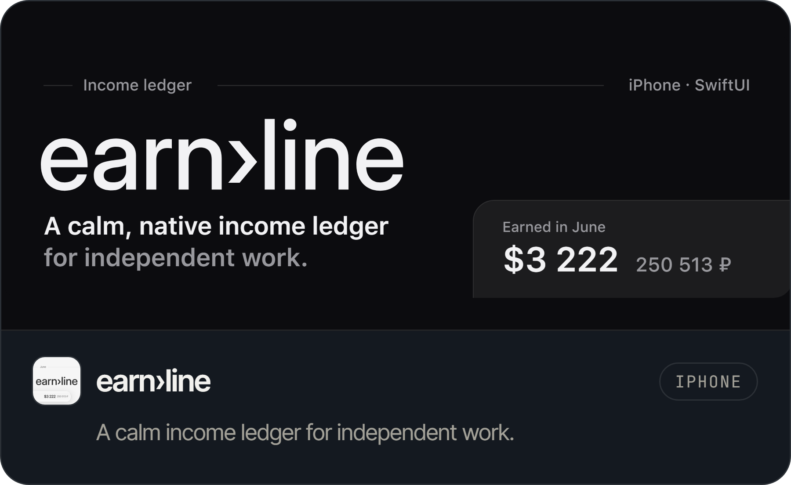</a>
  <a href="https://github.com/Piwqust/Cutoff#gh-dark-mode-only">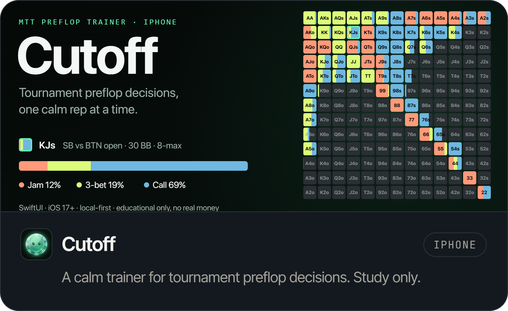</a>

  <a href="https://github.com/Piwqust/pinterest-plus-plus#gh-light-mode-only">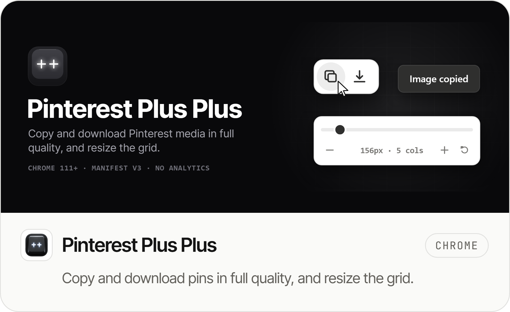</a>
  <a href="https://github.com/Piwqust/blackboard#gh-light-mode-only">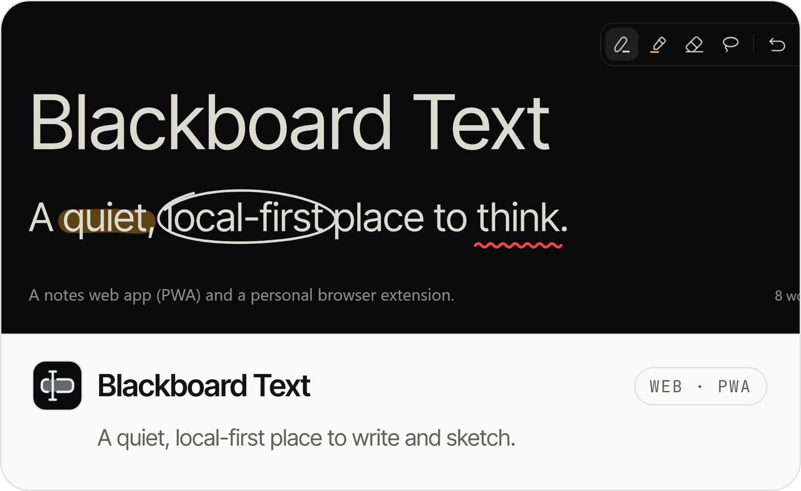</a>
  <a href="https://github.com/Piwqust/pinterest-plus-plus#gh-dark-mode-only">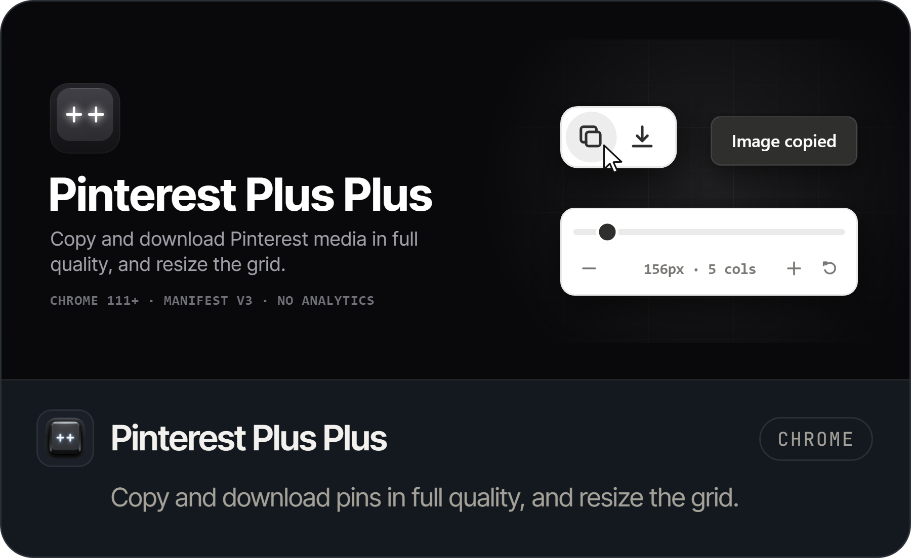</a>
  <a href="https://github.com/Piwqust/blackboard#gh-dark-mode-only">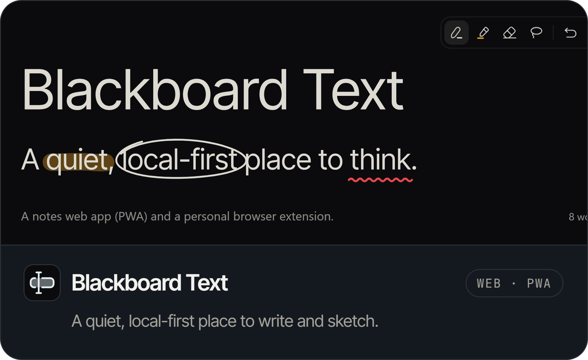</a>

Also: [**LintSense**](https://github.com/Piwqust/lintsense), a Figma plugin that turns a file's colors and type into Variables and Text Styles, and [**Lyrics Live**](https://github.com/Piwqust/LyricsLive-releases), song lyrics on stage for Resolume.

Figma · TypeScript · React · Swift & SwiftUI · C++ · Rust & WebAssembly · Python · Tauri
