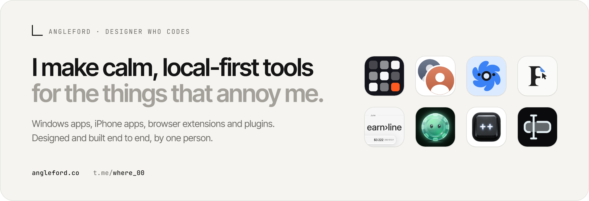
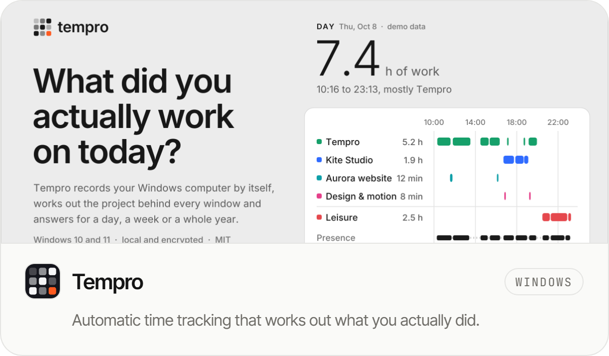
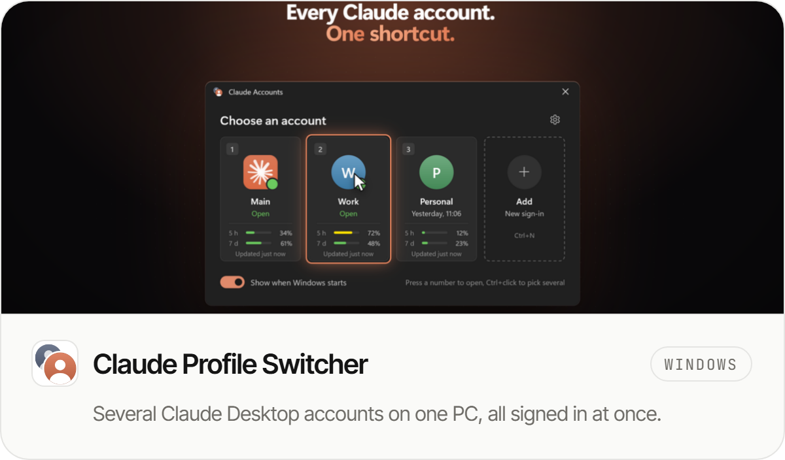
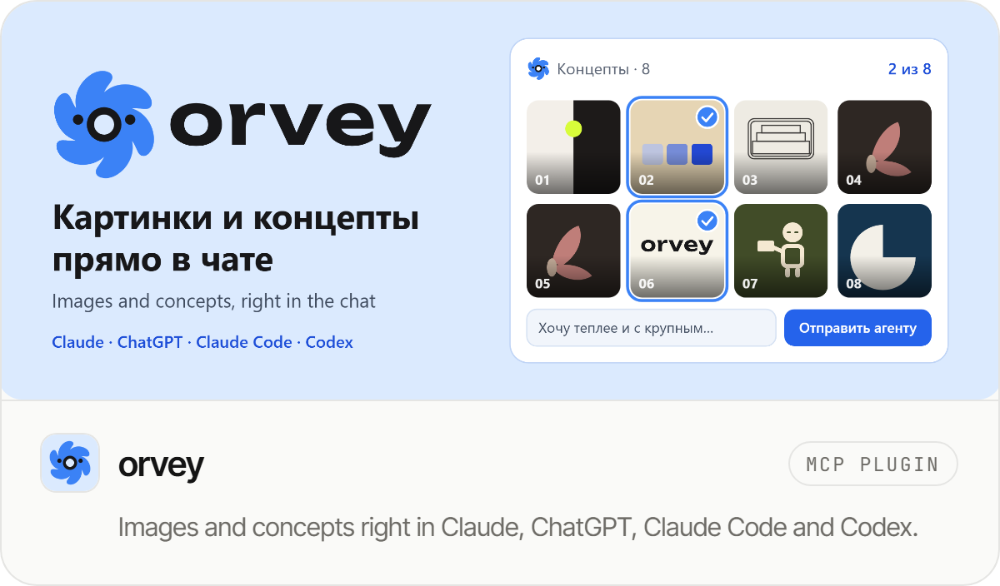
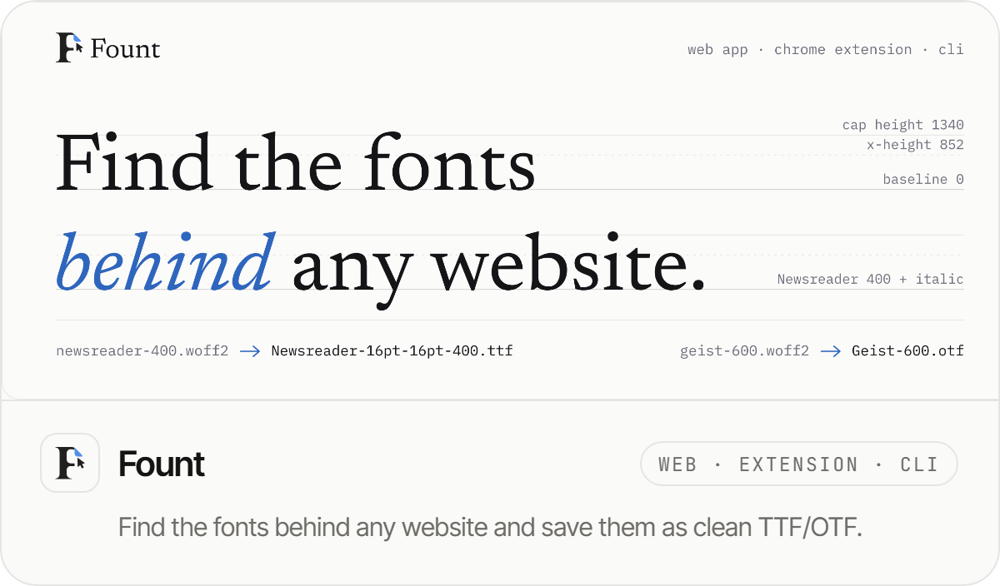
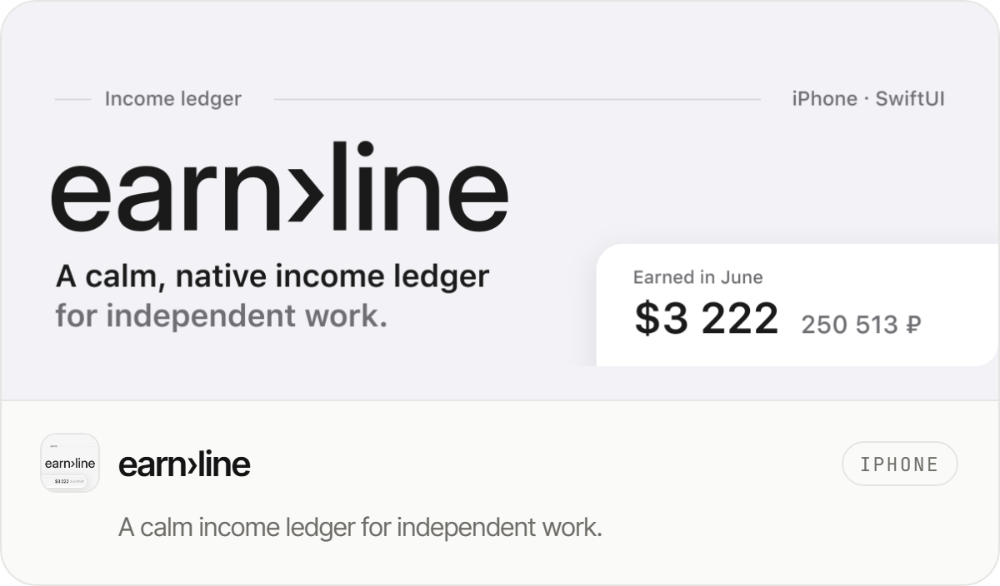
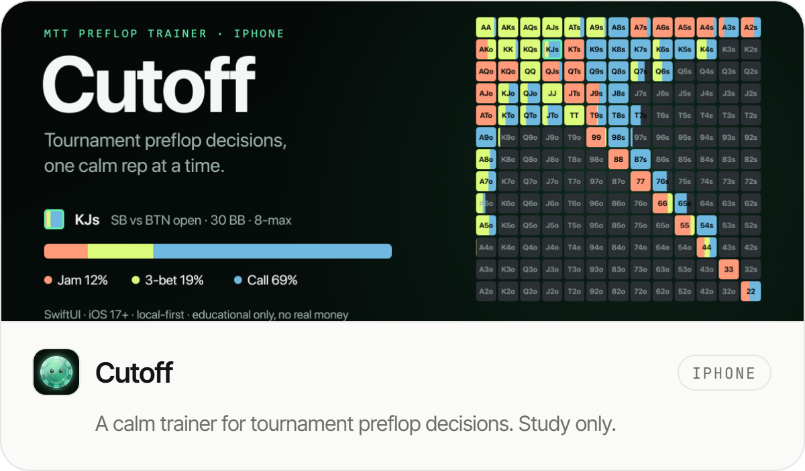
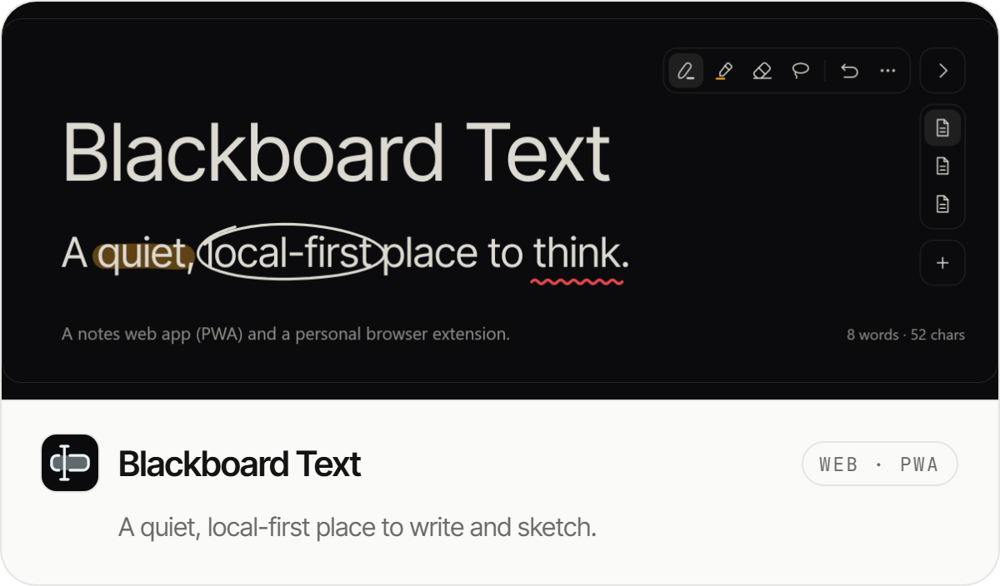

<picture>
  <source media="(prefers-color-scheme: dark)" srcset="assets/hero-dark.png">
  
</picture>

  <a href="https://angleford.co">angleford.co</a> &nbsp;·&nbsp; <a href="https://t.me/where_00">Telegram</a>

### Selected work

  <picture><source media="(prefers-color-scheme: dark)" srcset="assets/card-tempro-dark.png"></picture>
  <picture><source media="(prefers-color-scheme: dark)" srcset="assets/card-claude-switcher-dark.png"></picture>

  <picture><source media="(prefers-color-scheme: dark)" srcset="assets/card-orvey-plugin-dark.png"></picture>
  <picture><source media="(prefers-color-scheme: dark)" srcset="assets/card-font-grabber-dark.png"></picture>

  <picture><source media="(prefers-color-scheme: dark)" srcset="assets/card-earnline-dark.png"></picture>
  <picture><source media="(prefers-color-scheme: dark)" srcset="assets/card-cutoff-dark.png"></picture>

  <picture><source media="(prefers-color-scheme: dark)" srcset="assets/card-pinterest-plus-plus-dark.png"></picture>
  <picture><source media="(prefers-color-scheme: dark)" srcset="assets/card-blackboard-dark.png"></picture>

Also: [**LintSense**](https://github.com/Piwqust/lintsense), a Figma plugin that turns a file's colors and type into Variables and Text Styles, and [**Lyrics Live**](https://github.com/Piwqust/LyricsLive-releases), song lyrics on stage for Resolume.

Figma · TypeScript · React · Swift & SwiftUI · C++ · Rust & WebAssembly · Python · Tauri
